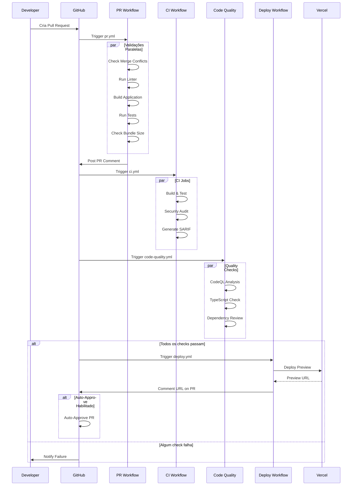
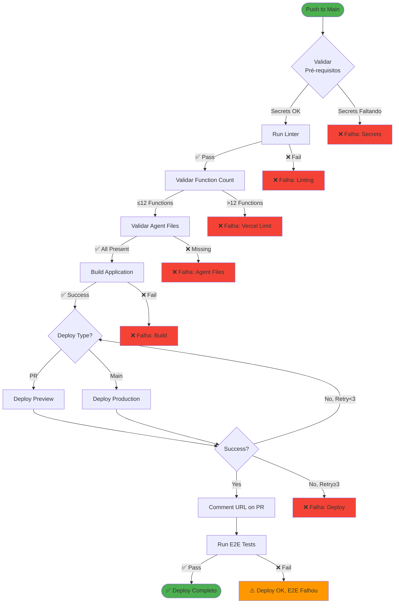
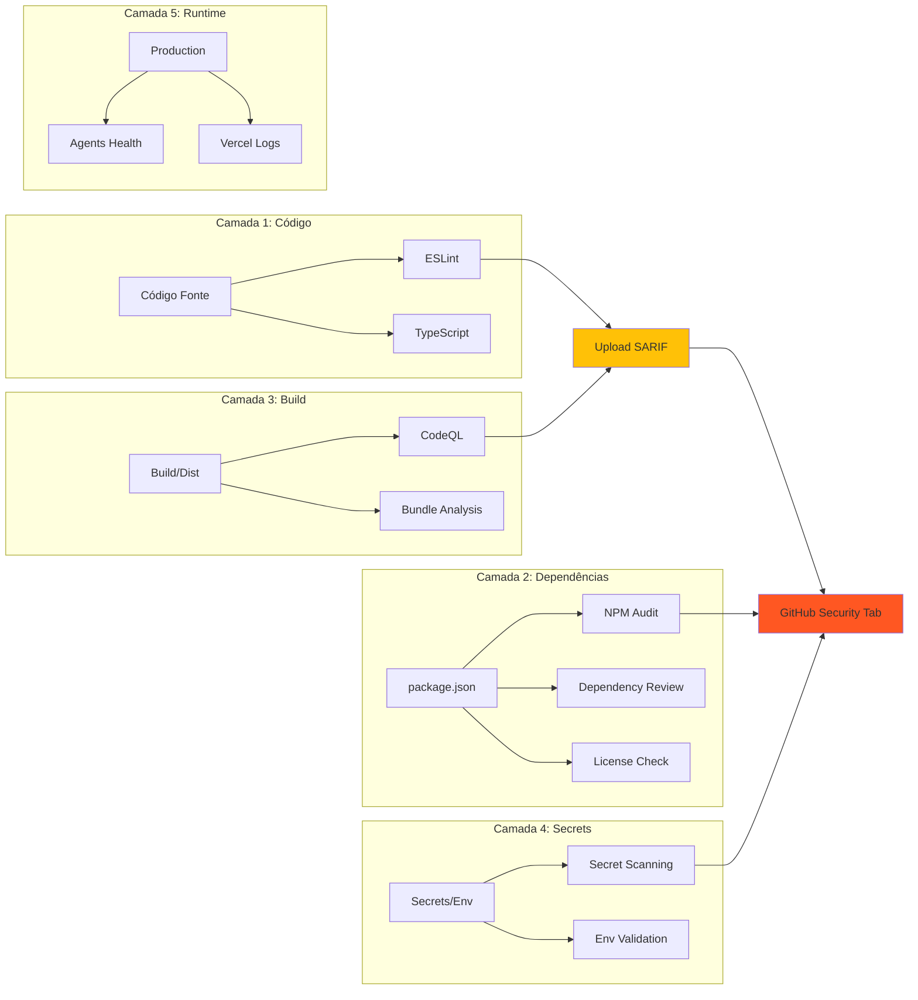
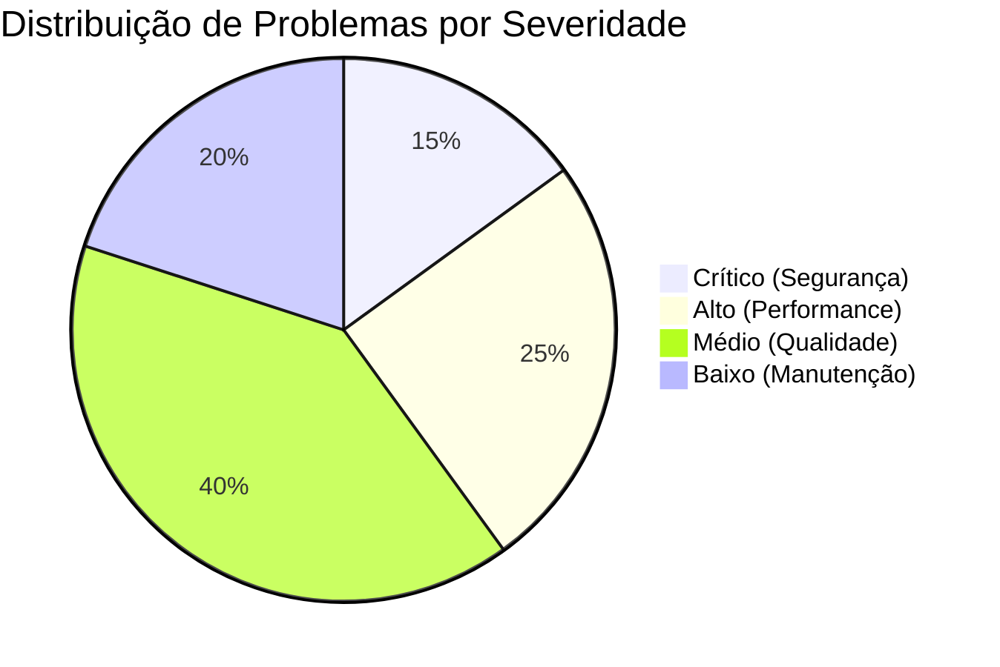
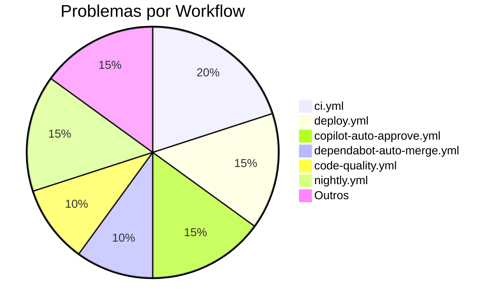
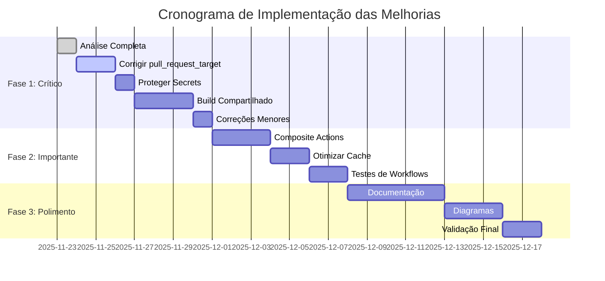
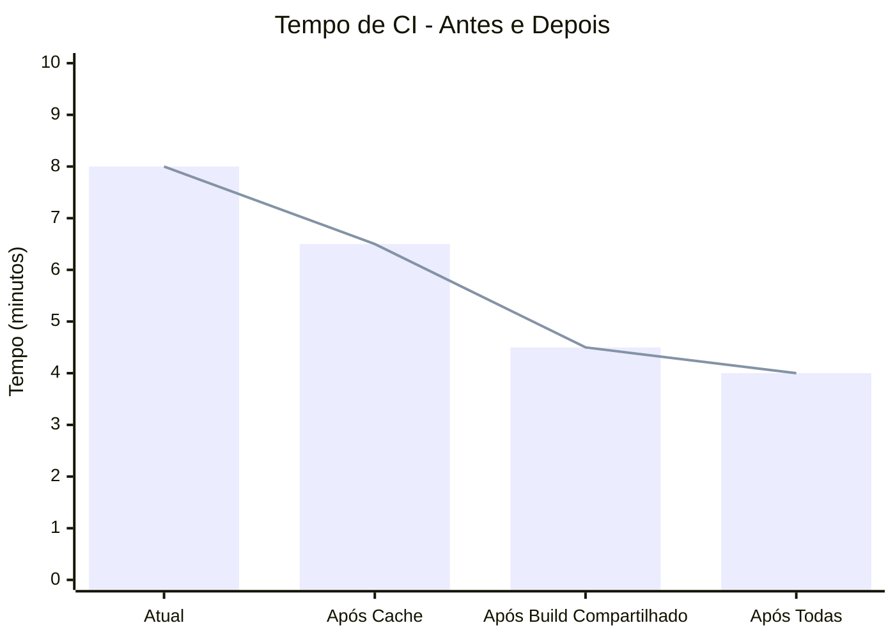
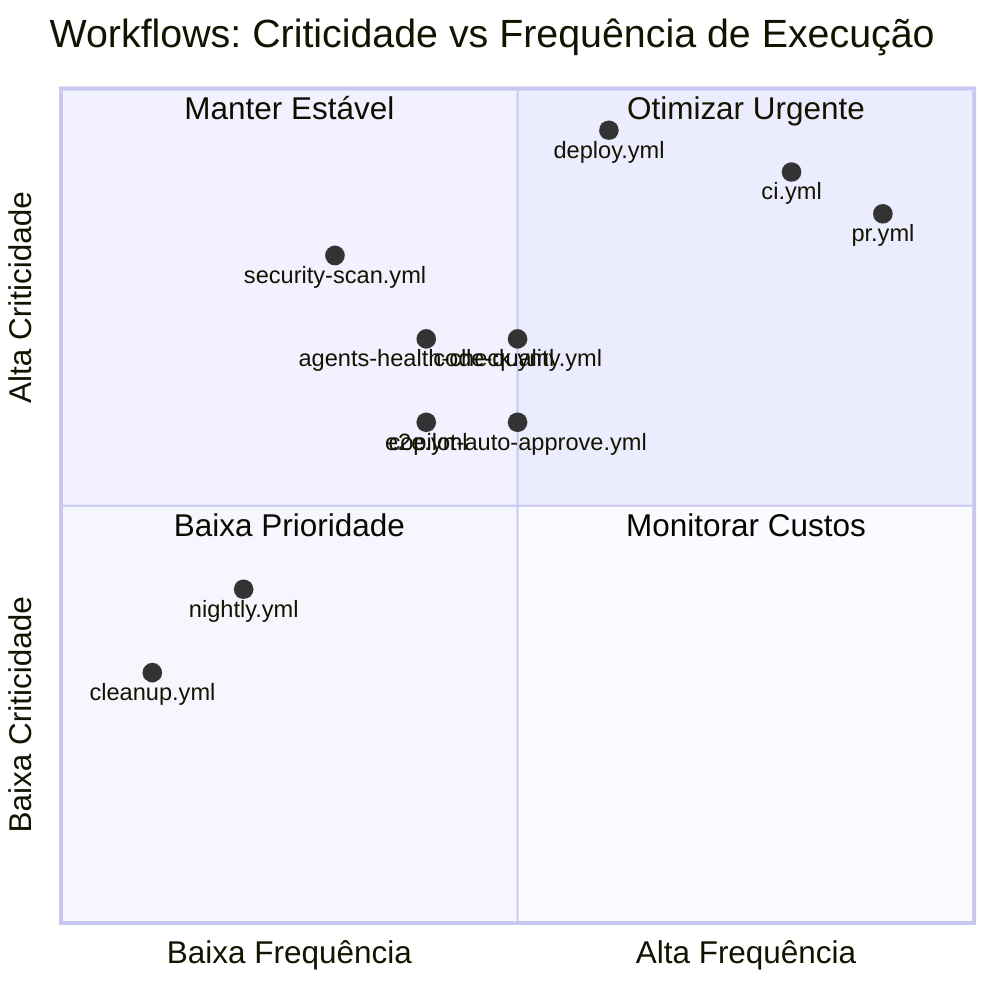

# Diagrama de Workflows - GitHub Actions

Este documento apresenta uma visualização dos workflows e suas dependências.

---

## 🗺️ Mapa de Workflows

```mermaid
graph TD
    subgraph "Triggers Principais"
        PR[Pull Request]
        PUSH[Push to Main]
        SCHEDULE[Schedule/Cron]
        MANUAL[Manual Dispatch]
    end

    subgraph "CI/CD Pipeline"
        PR --> PR_WORKFLOW[pr.yml<br/>Validação de PR]
        PR --> AUTOFIX[autofix.yml<br/>Auto-fix Linting]
        PR --> COPILOT_APPROVE[copilot-auto-approve.yml<br/>Auto Approve]
        PR --> DEPENDABOT[dependabot-auto-merge.yml<br/>Auto Merge Deps]
        
        PUSH --> CI[ci.yml<br/>Build & Test]
        PUSH --> DEPLOY[deploy.yml<br/>Deploy Vercel]
        PUSH --> CODE_QUALITY[code-quality.yml<br/>CodeQL & Quality]
        PUSH --> AGENTS_HEALTH[agents-health-check.yml<br/>Health Check]
        
        SCHEDULE --> SECURITY[security-scan.yml<br/>Security Scans]
        SCHEDULE --> NIGHTLY[nightly.yml<br/>Nightly Build]
        SCHEDULE --> CLEANUP[cleanup.yml<br/>Cleanup Old Data]
        
        MANUAL --> E2E[e2e.yml<br/>E2E Tests]
        MANUAL --> PERFORMANCE[performance.yml<br/>Performance Tests]
    end

    subgraph "Deploy Pipeline"
        DEPLOY --> VERCEL_PREVIEW[Preview Deploy]
        DEPLOY --> VERCEL_PROD[Production Deploy]
        DEPLOY --> E2E_AFTER[E2E Tests]
    end

    subgraph "Quality Gates"
        PR_WORKFLOW --> LINT[Lint Check]
        PR_WORKFLOW --> BUILD[Build Check]
        PR_WORKFLOW --> TEST[Test Check]
        PR_WORKFLOW --> CONFLICTS[Merge Conflicts]
        
        CI --> LINT_CI[ESLint + SARIF]
        CI --> BUILD_CI[Build Artifacts]
        CI --> TEST_CI[Unit Tests]
        CI --> AUDIT[NPM Audit]
        
        CODE_QUALITY --> CODEQL[CodeQL Analysis]
        CODE_QUALITY --> TYPE_CHECK[TypeScript Check]
        CODE_QUALITY --> BUNDLE_SIZE[Bundle Size]
    end

    subgraph "Security Layers"
        SECURITY --> NPM_AUDIT[NPM Audit]
        SECURITY --> SECRET_SCAN[Secret Scanning]
        SECURITY --> LICENSE[License Check]
        
        CODEQL --> SARIF[SARIF Upload]
        LINT_CI --> SARIF
    end

    style PR fill:#e1f5fe
    style PUSH fill:#fff3e0
    style SCHEDULE fill:#f3e5f5
    style MANUAL fill:#e8f5e9
    
    style COPILOT_APPROVE fill:#ffcdd2
    style DEPENDABOT fill:#ffcdd2
    style DEPLOY fill:#fff59d
    style SECURITY fill:#c8e6c9
```



---

## 🔄 Fluxo de um Pull Request



---

## 🏗️ Pipeline de Deploy



---

## 🔒 Camadas de Segurança



---

## 📊 Problemas Identificados por Categoria





---

## ⏱️ Timeline de Otimização



---

## 📈 Impacto das Otimizações



---

## 🎯 Workflows Críticos vs Normais



---

## 🔐 Matriz de Risco de Segurança

| Workflow | pull_request_target | Secrets Exposure | Permissions | Score |
|----------|---------------------|------------------|-------------|-------|
| copilot-auto-approve.yml | 🔴 Alto | 🟡 Médio | 🟡 Médio | 6/10 |
| dependabot-auto-merge.yml | 🔴 Alto | 🟡 Médio | 🔴 Alto | 5/10 |
| deploy.yml | 🟢 Baixo | 🔴 Alto | 🟡 Médio | 6/10 |
| ci.yml | 🟢 Baixo | 🟢 Baixo | 🟢 Baixo | 9/10 |
| pr.yml | 🟢 Baixo | 🟢 Baixo | 🟡 Médio | 8/10 |
| security-scan.yml | 🟢 Baixo | 🟢 Baixo | 🟡 Médio | 8/10 |

**Legenda:**
- 🔴 Alto Risco - Requer correção imediata
- 🟡 Médio Risco - Requer atenção
- 🟢 Baixo Risco - Aceitável

---

## 📊 Dashboard de Métricas

### Antes das Otimizações
```
┌─────────────────────────────────────────────┐
│  CI Performance Dashboard                   │
├─────────────────────────────────────────────┤
│  Tempo Médio de CI:        8.2 min         │
│  Builds/Dia:               ~15              │
│  Consumo Mensal:           1200 min         │
│  Cache Hit Rate:           58%              │
│  Taxa de Falha:            12%              │
│  Score de Segurança:       6.5/10           │
└─────────────────────────────────────────────┘
```

### Depois das Otimizações (Meta)
```
┌─────────────────────────────────────────────┐
│  CI Performance Dashboard                   │
├─────────────────────────────────────────────┤
│  Tempo Médio de CI:        4.0 min  ⬇️ 51% │
│  Builds/Dia:               ~15              │
│  Consumo Mensal:           700 min  ⬇️ 42%  │
│  Cache Hit Rate:           85%      ⬆️ 47%  │
│  Taxa de Falha:            8%       ⬇️ 33%  │
│  Score de Segurança:       8.5/10   ⬆️ 31%  │
└─────────────────────────────────────────────┘
```

---

**Nota:** Estes diagramas são renderizados automaticamente no GitHub quando visualizados em um arquivo Markdown. Para melhor visualização, abra este arquivo diretamente no GitHub.

---

**Criado por:** GitHub Copilot AI Agent  
**Data:** 23/11/2025  
**Baseado em:** Análise completa de 16 workflows
