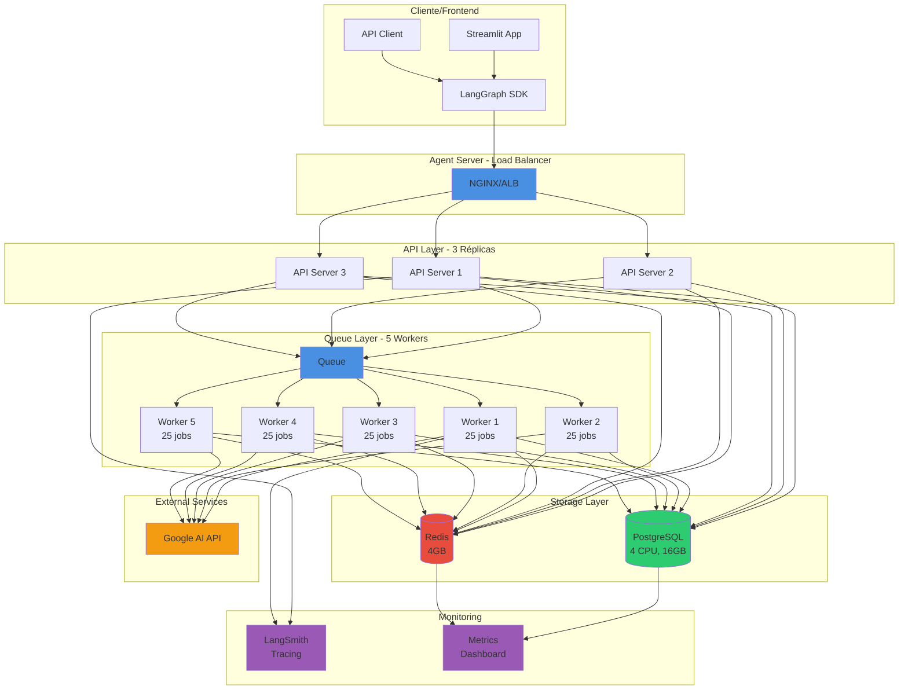
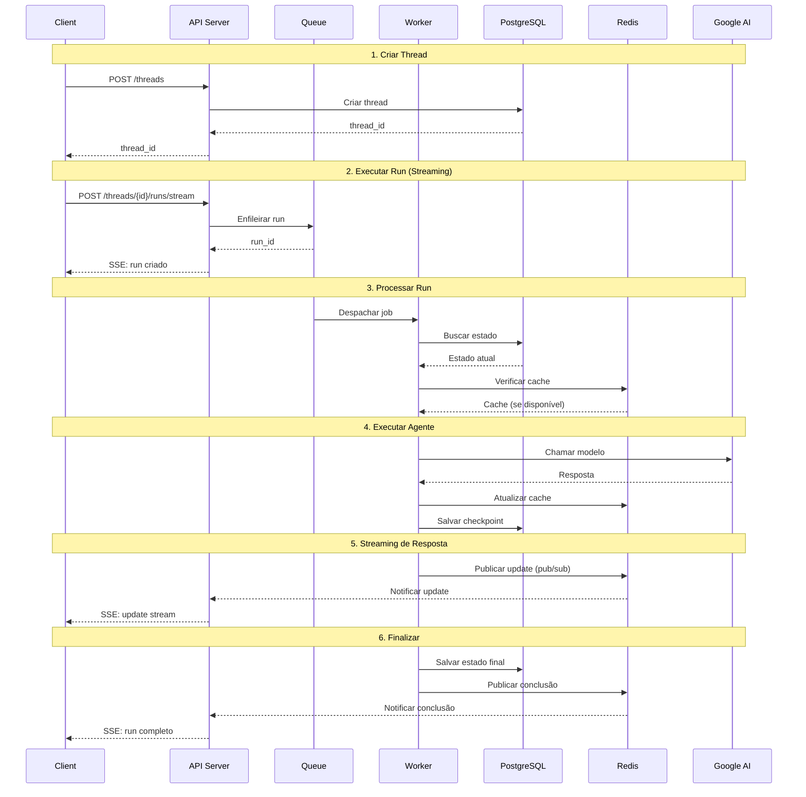

# 🏗️ Arquitetura de Escala - Agent Server

## Visão Geral da Arquitetura



## Fluxo de Requisição



## Componentes e Responsabilidades

### 1. API Servers (3 réplicas)

```
┌─────────────────────────────────┐
│     API Server                  │
├─────────────────────────────────┤
│ • Receber requests HTTP         │
│ • Validar inputs                │
│ • Autenticação                  │
│ • Enfileirar runs               │
│ • Streaming (SSE)               │
│ • Buscar resultados             │
└─────────────────────────────────┘
         ↓
    PostgreSQL + Redis
```

**Capacidade**: ~100 req/s por servidor = 300 req/s total

### 2. Queue Workers (5 réplicas)

```
┌─────────────────────────────────┐
│     Queue Worker                │
├─────────────────────────────────┤
│ • Executar agentes              │
│ • Gerenciar checkpoints         │
│ • Chamar LLMs                   │
│ • Pub/Sub updates               │
│ • Error handling                │
└─────────────────────────────────┘
    25 jobs/worker × 5 workers
    = 125 jobs concorrentes
```

**Throughput**: 125 jobs / 2s avg = 62.5 req/s

### 3. PostgreSQL

```
┌─────────────────────────────────┐
│     PostgreSQL                  │
│     4 CPU, 16GB RAM             │
├─────────────────────────────────┤
│ • Threads                       │
│ • Runs                          │
│ • Checkpoints                   │
│ • Assistants                    │
│ • Cron jobs                     │
│ • Long-term memory              │
└─────────────────────────────────┘
    Pool: 20 conexões
    Max overflow: 10
```

**Capacidade**: ~500 queries/s

### 4. Redis

```
┌─────────────────────────────────┐
│     Redis                       │
│     4GB RAM                     │
├─────────────────────────────────┤
│ • Pub/Sub streaming             │
│ • Cache de runs ativos          │
│ • Session storage               │
│ • Rate limiting                 │
└─────────────────────────────────┘
    Pool: 50 conexões
```

**Capacidade**: ~10k ops/s

## Escalonamento por Carga

### Carga Baixa (5 req/s)
```
┌─────────┐
│ API: 1  │──┐
└─────────┘  │
             ├──► DB (2 CPU, 8GB)
┌─────────┐  │
│Worker: 1│──┤
│10 jobs  │  │
└─────────┘  └──► Redis (2GB)
```

### Carga Média (50 req/s) ⭐ ATUAL
```
┌─────────┐
│ API: 3  │──┐
└─────────┘  │
             │
┌─────────┐  │
│Worker: 5│──┼──► DB (4 CPU, 16GB)
│25 jobs  │  │
└─────────┘  │
             └──► Redis (4GB)
```

### Carga Alta (500 req/s)
```
┌─────────┐
│ API: 15 │──┐
└─────────┘  │
┌─────────┐  │
│Autoscale│  │
│  →25    │  │
└─────────┘  │
             │
┌─────────┐  │
│Worker:10│──┼──► DB (8 CPU, 32GB)
│50 jobs  │  │
└─────────┘  │
┌─────────┐  │
│Autoscale│  │
│  →20    │  │
└─────────┘  └──► Redis (8GB)
```

## Monitoramento e Alertas

```
┌──────────────────────────────────────────┐
│           LangSmith Dashboard            │
├──────────────────────────────────────────┤
│                                          │
│  📊 Métricas em Tempo Real               │
│  ├─ Runs/segundo                         │
│  ├─ Latência (p50, p95, p99)            │
│  ├─ Taxa de sucesso                      │
│  └─ Tamanho da fila                      │
│                                          │
│  🔔 Alertas Configurados                 │
│  ├─ Latência > 5s                        │
│  ├─ Taxa erro > 5%                       │
│  ├─ Fila > 1000                          │
│  └─ CPU > 70%                            │
│                                          │
│  📈 Gráficos                             │
│  ├─ Throughput                           │
│  ├─ Uso de recursos                      │
│  └─ Distribuição de latência             │
│                                          │
└──────────────────────────────────────────┘
```

## Fluxo de Deployment

```
┌────────────┐
│ 1. Código  │
│   GitHub   │
└──────┬─────┘
       │
       ▼
┌────────────┐     ┌──────────────┐
│ 2. Build   │────►│ 3. Testes    │
│   Docker   │     │   CI/CD      │
└──────┬─────┘     └──────┬───────┘
       │                  │
       │     ✅ Pass      │
       ▼                  ▼
┌────────────┐     ┌──────────────┐
│ 4. Push    │────►│ 5. Deploy    │
│  Registry  │     │   Staging    │
└────────────┘     └──────┬───────┘
                          │
                   📊 Validação
                          │
                          ▼
                   ┌──────────────┐
                   │ 6. Deploy    │
                   │  Production  │
                   └──────────────┘
```

## Otimizações Aplicadas

### 1. Performance
```
✅ N_JOBS_PER_WORKER=25 (I/O bound)
✅ Connection pooling otimizado
✅ Durability configurável
✅ Cache agressivo
```

### 2. Escala
```
✅ Horizontal scaling (API + Workers)
✅ Autoscaling configurado
✅ Load balancing
✅ Database read replicas (opcional)
```

### 3. Confiabilidade
```
✅ Health checks
✅ Graceful shutdown
✅ Retry logic
✅ Circuit breaker
```

### 4. Observabilidade
```
✅ Tracing (LangSmith)
✅ Metrics (Prometheus)
✅ Logs (structured JSON)
✅ Alertas
```

## Custos Estimados (Mensal)

```
┌────────────────────────────────────────┐
│ Configuração Média (50 req/s)         │
├────────────────────────────────────────┤
│ API Servers (3×)          $150         │
│ Queue Workers (5×)        $250         │
│ PostgreSQL RDS            $100         │
│ Redis (Upstash/Cache)     $50          │
│ LLM APIs (Google AI)      $200         │
│ LangSmith                 $50          │
├────────────────────────────────────────┤
│ TOTAL                     ~$800/mês    │
└────────────────────────────────────────┘

💡 Otimizações para reduzir custos:
• Reserved instances (DB)
• Spot instances (Workers)
• Cache agressivo (reduz chamadas LLM)
• TTL otimizado (reduz storage)
```

## Checklist de Produção

```
✅ Configuração
├─ langgraph.json atualizado
├─ .env.production configurado
├─ deployment-config.yaml revisado
└─ Secrets gerenciados

✅ Database
├─ PostgreSQL externo provisionado
├─ Backups configurados
├─ SSL habilitado
└─ Pool otimizado

✅ Monitoramento
├─ LangSmith tracing ativo
├─ Alertas configurados
├─ Dashboards criados
└─ Scripts de monitoring rodando

✅ Segurança
├─ API keys em secrets
├─ CORS configurado
├─ Rate limiting ativo
└─ SSL/TLS habilitado

✅ Performance
├─ N_JOBS_PER_WORKER ajustado
├─ TTL configurado
├─ Cache otimizado
└─ Autoscaling habilitado
```

## Próximos Passos

1. **Revisar configurações** → AGENT_SERVER_SCALE_CONFIG.md
2. **Calcular capacidade** → `python scripts/calculate_capacity.py`
3. **Seguir checklist** → DEPLOYMENT_CHECKLIST.md
4. **Deploy staging** → Testar configuração
5. **Monitorar** → `python scripts/monitor_metrics.py`
6. **Deploy production** → Quando tudo estiver validado
