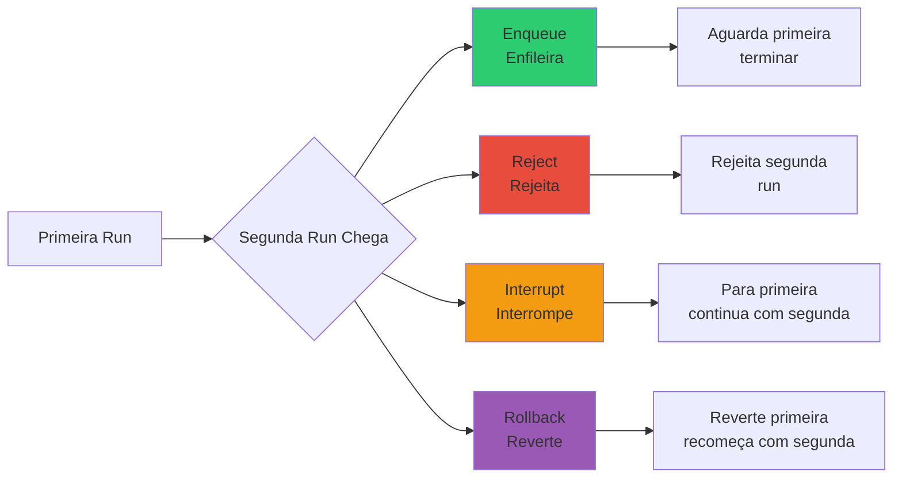

# 🔄 Double Texting e Estratégias de Multitasking

## O que é Double Texting?

**Double texting** ocorre quando um usuário envia uma segunda mensagem ou inicia uma nova execução antes que a primeira tenha terminado. Isso é comum em aplicações de chat onde usuários são impacientes ou mudam de ideia rapidamente.

## 🎯 Estratégias Disponíveis

O LangSmith Agent Server oferece 4 estratégias para lidar com double texting:



### 1. Enqueue (Padrão) ⭐

**Como funciona:**
- A primeira run continua até o fim
- A segunda run é adicionada a uma fila
- Quando a primeira termina, a segunda começa

**Quando usar:**
- Quando todas as mensagens são importantes
- Em atendimento ao cliente (não perder contexto)
- Quando a ordem das mensagens importa

**Exemplo de uso:**

```python
from langgraph_sdk import get_client

client = get_client(url="<DEPLOYMENT_URL>")
thread_id = "thread-123"

# Primeira run
run1 = await client.runs.create(
    thread_id,
    "legal_assistant",
    input={"messages": [{"role": "user", "content": "Analise este contrato"}]}
)

# Segunda run (será enfileirada automaticamente)
run2 = await client.runs.create(
    thread_id,
    "legal_assistant",
    input={"messages": [{"role": "user", "content": "Quanto tempo vai demorar?"}]},
    multitask_strategy="enqueue"  # Padrão
)

# Aguardar ambas terminarem
await client.runs.join(thread_id, run2["run_id"])
```

**Resultado:**
```
👤 Usuário: Analise este contrato
🤖 Assistente: [análise completa do contrato...]
👤 Usuário: Quanto tempo vai demorar?
🤖 Assistente: A análise levou 2 minutos...
```

---

### 2. Reject ❌

**Como funciona:**
- A primeira run continua
- A segunda run é rejeitada imediatamente
- Retorna erro HTTP 409 (Conflict)

**Quando usar:**
- Quando apenas uma execução deve acontecer por vez
- Em tarefas longas e custosas
- Para evitar processamento duplicado

**Exemplo de uso:**

```python
try:
    # Primeira run (em andamento)
    run1 = await client.runs.create(
        thread_id,
        "legal_assistant",
        input={"messages": [{"role": "user", "content": "Gerar relatório completo"}]}
    )

    # Segunda run (será rejeitada)
    run2 = await client.runs.create(
        thread_id,
        "legal_assistant",
        input={"messages": [{"role": "user", "content": "Cancelar e fazer outro"}]},
        multitask_strategy="reject"
    )
except Exception as e:
    print(f"Run rejeitada: {e}")
    # Aguardar primeira terminar ou cancelá-la
    await client.runs.cancel(thread_id, run1["run_id"])
```

**Configuração no código:**

```python
# Definir reject como padrão no deployment
# Em langgraph.json:
{
  "http": {
    "default_multitask_strategy": "reject"
  }
}
```

---

### 3. Interrupt ⚡

**Como funciona:**
- A primeira run é interrompida onde está
- O progresso até aquele ponto é salvo
- A segunda run continua a partir dali com novo input

**Quando usar:**
- Quando usuário muda de ideia rapidamente
- Para correções de curso imediatas
- Em conversas iterativas

**Exemplo de uso:**

```python
# Primeira run (longa)
run1 = await client.runs.create(
    thread_id,
    "legal_assistant",
    input={"messages": [{"role": "user", "content": "Analise todos os 50 documentos"}]}
)

# Usuário percebe erro e interrompe
run2 = await client.runs.create(
    thread_id,
    "legal_assistant",
    input={"messages": [{"role": "user", "content": "Na verdade, analise apenas os 10 primeiros"}]},
    multitask_strategy="interrupt"
)
```

**⚠️ Atenção:**
- Pode deixar operações incompletas (ex: tool calls parciais)
- Seu grafo deve tratar esses casos
- Recomenda-se limpar estado inconsistente

**Tratamento de casos edge:**

```python
# No seu grafo, adicione tratamento
def cleanup_partial_operations(state):
    """Remove tool calls incompletos após interrupt"""
    if state.get("interrupted"):
        # Remover tool calls sem resposta
        state["messages"] = [
            msg for msg in state["messages"]
            if not (msg.type == "tool" and msg.status == "pending")
        ]
    return state
```

---

### 4. Rollback ⏮️

**Como funciona:**
- A primeira run é interrompida
- TODO o progresso é descartado (incluindo input inicial)
- A segunda run começa do zero

**Quando usar:**
- Quando usuário quer começar completamente do zero
- Para cancelar e substituir totalmente
- Quando contexto anterior não importa

**Exemplo de uso:**

```python
# Primeira run (usuário se enganou completamente)
run1 = await client.runs.create(
    thread_id,
    "legal_assistant",
    input={"messages": [{"role": "user", "content": "Analise processo trabalhista"}]}
)

# Usuário percebe que é processo cível
run2 = await client.runs.create(
    thread_id,
    "legal_assistant",
    input={"messages": [{"role": "user", "content": "Analise processo cível"}]},
    multitask_strategy="rollback"
)

# Run1 é completamente descartada
# Run2 começa como se fosse a primeira mensagem
```

**Diferença entre Interrupt e Rollback:**

| Aspecto | Interrupt | Rollback |
|---------|-----------|----------|
| **Progresso** | Mantém até ponto de interrupção | Descarta tudo |
| **Contexto** | Preserva mensagens anteriores | Remove tudo |
| **Uso** | Ajuste de direção | Recomeçar do zero |

---

## 📊 Tabela Comparativa

| Estratégia | Primeira Run | Segunda Run | Contexto | Quando Usar |
|------------|-------------|-------------|----------|-------------|
| **Enqueue** ✅ | Termina | Espera e executa | Mantém tudo | Todas mensagens importantes |
| **Reject** ❌ | Termina | Rejeitada | Mantém primeira | Evitar duplicação |
| **Interrupt** ⚡ | Para | Continua do ponto | Mantém parcial | Mudança de direção |
| **Rollback** ⏮️ | Cancela | Recomeça do zero | Remove tudo | Recomeçar totalmente |

---

## 🎯 Casos de Uso Práticos

### Caso 1: Assistente Jurídico (Enqueue)

**Cenário:** Usuário enviando documentos para análise

```python
# Usuário envia vários documentos rapidamente
docs = ["contrato.pdf", "procuracao.pdf", "petição.pdf"]

for doc in docs:
    run = await client.runs.create(
        thread_id,
        "legal_assistant",
        input={"messages": [{"role": "user", "content": f"Analise {doc}"}]},
        multitask_strategy="enqueue"  # Processa todos em ordem
    )
```

**Resultado:** Todos os documentos são analisados na ordem enviada.

---

### Caso 2: Geração de Relatório Longo (Reject)

**Cenário:** Relatório demorado, não aceitar duplicatas

```python
# Proteger contra múltiplas gerações
try:
    run = await client.runs.create(
        thread_id,
        "legal_assistant",
        input={"messages": [{"role": "user", "content": "Gerar relatório anual"}]},
        multitask_strategy="reject"
    )
except Exception:
    # Informar usuário que já está processando
    print("Já existe um relatório sendo gerado. Aguarde...")
```

---

### Caso 3: Busca Iterativa (Interrupt)

**Cenário:** Usuário refinando busca em tempo real

```python
# Busca inicial (demorada)
run1 = await client.runs.create(
    thread_id,
    "legal_assistant",
    input={"messages": [{"role": "user", "content": "Buscar jurisprudência sobre contratos"}]}
)

# Usuário refina (interrompe a primeira)
run2 = await client.runs.create(
    thread_id,
    "legal_assistant",
    input={"messages": [{"role": "user", "content": "Buscar apenas contratos de prestação de serviços após 2020"}]},
    multitask_strategy="interrupt"
)
```

---

### Caso 4: Correção de Erro (Rollback)

**Cenário:** Usuário enviou thread/contexto errado

```python
# Usuário enviou no thread errado
run1 = await client.runs.create(
    thread_id_errado,
    "legal_assistant",
    input={"messages": [{"role": "user", "content": "..."}]}
)

# Recomeçar no thread certo, descartando tudo
run2 = await client.runs.create(
    thread_id_certo,
    "legal_assistant",
    input={"messages": [{"role": "user", "content": "..."}]},
    multitask_strategy="rollback"
)
```

---

## ⚙️ Configuração Global

### Via langgraph.json

```json
{
  "http": {
    "default_multitask_strategy": "enqueue",
    "allow_multitask_strategies": ["enqueue", "reject", "interrupt"]
  }
}
```

### Via Código do Grafo

```python
from langgraph.graph import StateGraph

# Definir estratégia padrão no grafo
graph = StateGraph(State)
# ... adicionar nós ...
graph = graph.compile(
    checkpointer=checkpointer,
    interrupt_before=["human_approval"],  # Para interrupt funcionar
)
```

---

## 🔍 Monitoramento

### Verificar status de runs

```python
# Ver todas as runs em um thread
runs = await client.runs.list(thread_id)

for run in runs:
    print(f"Run {run['run_id']}: {run['status']}")
    if run['status'] == 'interrupted':
        print(f"  Interrompida em: {run['interrupted_at']}")
```

### Métricas importantes

```python
# Contar runs por status
from collections import Counter

runs = await client.runs.list(thread_id, limit=1000)
status_counts = Counter(run['status'] for run in runs)

print(f"Completadas: {status_counts['success']}")
print(f"Rejeitadas: {status_counts['rejected']}")
print(f"Interrompidas: {status_counts['interrupted']}")
print(f"Revertidas: {status_counts['rolled_back']}")
```

---

## 💡 Melhores Práticas

### 1. Escolher a estratégia certa

```python
# Mapeamento de casos de uso
STRATEGY_MAP = {
    "chat": "enqueue",          # Chat: todas mensagens importam
    "report": "reject",         # Relatórios: evitar duplicação
    "search": "interrupt",      # Busca: permitir refinamento
    "correction": "rollback"    # Correção: recomeçar
}

strategy = STRATEGY_MAP.get(task_type, "enqueue")
```

### 2. UI responsiva

```python
async def handle_user_input(user_message, task_type):
    """Handle user input com estratégia apropriada"""

    try:
        run = await client.runs.create(
            thread_id,
            "legal_assistant",
            input={"messages": [{"role": "user", "content": user_message}]},
            multitask_strategy=STRATEGY_MAP[task_type]
        )

        # Streaming para UX melhor
        async for chunk in client.runs.stream(thread_id, run["run_id"]):
            yield chunk

    except Exception as e:
        if "409" in str(e):  # Reject
            yield {"error": "Aguarde a operação atual terminar"}
        else:
            raise
```

### 3. Tratamento de erros

```python
async def safe_create_run(thread_id, input_msg, strategy="enqueue"):
    """Criar run com tratamento de erros"""

    max_retries = 3

    for attempt in range(max_retries):
        try:
            run = await client.runs.create(
                thread_id,
                "legal_assistant",
                input=input_msg,
                multitask_strategy=strategy
            )
            return run

        except Exception as e:
            if "409" in str(e) and strategy == "reject":
                # Aguardar e tentar novamente
                await asyncio.sleep(2 ** attempt)
            else:
                raise

    raise Exception("Não foi possível criar run após tentativas")
```

---

## 📚 Referências

- [Documentação Oficial](https://docs.langchain.com/langsmith/double-texting)
- [Enqueue Guide](https://docs.langchain.com/langsmith/enqueue-concurrent)
- [API Reference](https://api.smith.langchain.com/redoc#operation/create_run)

---

## 🎯 Resumo

| ✅ Use Enqueue | ❌ Use Reject | ⚡ Use Interrupt | ⏮️ Use Rollback |
|----------------|---------------|-----------------|-----------------|
| Chat normal | Tarefas caras | Busca iterativa | Correção total |
| Todas msgs importam | Evitar duplicação | Mudança rápida | Contexto errado |
| Ordem importa | Uma por vez | Refinamento | Reset completo |

**Padrão recomendado:** `enqueue` - É o mais seguro e previsível.

---

**Criado em**: 30 de dezembro de 2025
**Versão**: 1.0
**Para mais informações**: Consulte [AGENT_SERVER_SCALE_CONFIG.md](AGENT_SERVER_SCALE_CONFIG.md)
