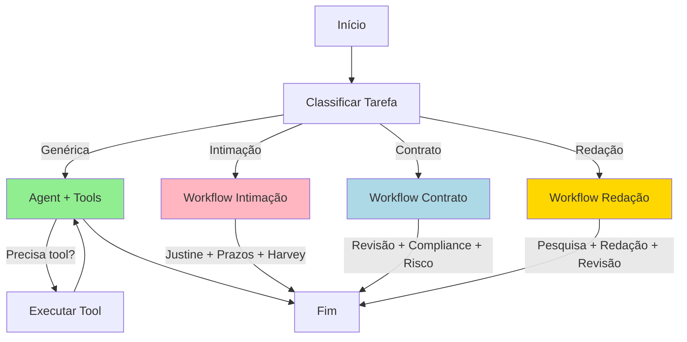

# Exemplos de Uso do Grafo Híbrido

Este documento mostra exemplos práticos de como usar o grafo híbrido `legal_hybrid` que integra os 16 agentes do assistente jurídico.

## 🎯 Características do Grafo Híbrido

O `legal_hybrid` combina:
- ✅ **16 agentes como tools** - LLM decide dinamicamente qual usar
- ✅ **3 workflows especializados** - Fluxos otimizados para tarefas comuns
- ✅ **Routing inteligente** - Classifica e direciona automaticamente

## 📊 Estrutura



## 💻 Exemplos Práticos

### Exemplo 1: Consulta Genérica (usa tools dinamicamente)

```python
from langgraph_sdk import get_client

client = get_client(url='http://127.0.0.1:2024')

# Criar thread
thread = await client.threads.create()

# Pergunta genérica - LLM escolhe qual agente usar
result = await client.runs.wait(
    thread['thread_id'],
    'legal_hybrid',
    input={
        'messages': [{
            'role': 'user',
            'content': 'Qual a diferença entre ação de cobrança e ação monitória?'
        }]
    }
)

print(result['messages'][-1]['content'])
```

**O que acontece:**
1. 🔍 Classifica como tarefa genérica
2. 🧠 LLM analisa e decide qual agente precisa
3. 🛠️ Chama `consultas_agent` automaticamente
4. ✅ Retorna resposta formatada

---

### Exemplo 2: Análise de Intimação (workflow especializado)

```python
# Intimação real
intimacao_texto = """
Intimação de Audiência
Processo: 1234567-89.2025.8.26.0100
Vara: 2ª Vara Cível
Data da Publicação: 15/01/2025
Assunto: Intimação para audiência de conciliação
Prazo: 15 dias corridos
Data da Audiência: 10/02/2025 às 14:00
"""

result = await client.runs.wait(
    thread['thread_id'],
    'legal_hybrid',
    input={
        'messages': [{
            'role': 'user',
            'content': f'Analisar intimação: {intimacao_texto}'
        }]
    }
)

print(result['messages'][-1]['content'])
```

**O que acontece:**
1. 🔍 Identifica palavras "intimação" e "prazo"
2. 📨 Aciona workflow especializado `intimacao_flow`
3. 🤖 Executa sequência:
   - Justine analisa intimação
   - Prazos calcula prazos
   - Harvey define estratégia
4. ✅ Retorna análise completa

**Resposta esperada:**
```
✅ Intimação Analisada:

📋 Análise: Intimação para audiência de conciliação
⏰ Prazo: 05/02/2025 (15 dias úteis)
🎯 Recomendação: Preparar proposta de acordo

Detalhes:
- Tipo: Audiência de Conciliação
- Necessário: Calcular proposta e preparar documentação
- Urgência: Média (prazo suficiente)
```

---

### Exemplo 3: Análise de Contrato (workflow especializado)

```python
contrato_texto = """
CONTRATO DE PRESTAÇÃO DE SERVIÇOS

As partes:
CONTRATANTE: Empresa XYZ LTDA
CONTRATADO: João Silva

Cláusula 1: Objeto - Prestação de serviços de consultoria
Cláusula 2: Prazo - 12 meses, renovável automaticamente
Cláusula 3: Valor - R$ 5.000,00 mensais
Cláusula 4: Multa - 50% do valor total em caso de rescisão
Cláusula 5: Dados - A CONTRATANTE poderá coletar e processar
            dados pessoais dos clientes sem restrições
"""

result = await client.runs.wait(
    thread['thread_id'],
    'legal_hybrid',
    input={
        'messages': [{
            'role': 'user',
            'content': f'Revisar contrato: {contrato_texto}'
        }]
    }
)

print(result['messages'][-1]['content'])
```

**O que acontece:**
1. 🔍 Identifica palavras "contrato" e "revisar"
2. 📄 Aciona workflow `contrato_flow`
3. 🤖 Executa sequência:
   - RevisaoAgent analisa cláusulas
   - ComplianceAgent verifica LGPD
   - AnaliseRiscoAgent avalia riscos
4. ✅ Retorna análise completa

**Resposta esperada:**
```
✅ Contrato Analisado:

📋 Cláusulas Problemáticas: 3
⚖️  Conformidade LGPD: Não Conforme
⚠️  Nível de Risco: Alto

Principais Achados:
- Cláusula 2: Renovação automática pode ser abusiva
- Cláusula 4: Multa de 50% é excessiva
- Cláusula 5: Violação da LGPD - necessário base legal e consentimento

Recomendações:
- Incluir cláusula de consentimento LGPD
- Reduzir multa para 20-30%
- Permitir cancelamento sem multa após 1º período
```

---

### Exemplo 4: Redação de Petição (workflow especializado)

```python
requisitos = """
Redigir petição inicial de ação de cobrança:

Cliente: Maria Santos
Réu: José Oliveira
Valor: R$ 15.000,00
Motivo: Empréstimo não pago
Data do empréstimo: 10/05/2024
Vencimento: 10/11/2024
Documentação: Contrato assinado e comprovante de transferência
"""

result = await client.runs.wait(
    thread['thread_id'],
    'legal_hybrid',
    input={
        'messages': [{
            'role': 'user',
            'content': f'Redigir petição: {requisitos}'
        }]
    }
)

print(result['messages'][-1]['content'])
```

**O que acontece:**
1. 🔍 Identifica palavras "petição" e "redigir"
2. ✍️  Aciona workflow `redacao_flow`
3. 🤖 Executa sequência:
   - PesquisaAgent busca jurisprudência
   - RedacaoAgent gera documento
   - RevisaoAgent faz revisão final
4. ✅ Retorna documento pronto

---

### Exemplo 5: Consulta Multi-Agente

```python
# Pergunta complexa que precisa de múltiplos agentes
result = await client.runs.wait(
    thread['thread_id'],
    'legal_hybrid',
    input={
        'messages': [{
            'role': 'user',
            'content': '''Tenho um processo trabalhista onde:
            1. Preciso calcular 13º salário e férias vencidas
            2. Verificar se há preclusão de algum direito
            3. Preparar uma proposta de acordo

            Funcionário trabalhou de 01/01/2023 a 30/06/2024
            Salário: R$ 3.500,00
            '''
        }]
    }
)
```

**O que acontece:**
1. 🔍 Classifica como tarefa genérica (múltiplas ações)
2. 🧠 LLM analisa e identifica necessidade de 3 agentes:
   - `calculos_agent` - Calcula 13º e férias
   - `prazos_agent` - Verifica preclusão
   - `acordo_agent` - Prepara proposta
3. 🛠️ Executa tools sequencialmente
4. ✅ Combina resultados e retorna resposta completa

---

## 📈 Comparação: Grafo Simples vs Híbrido

| Aspecto | Legal Assistant (Simples) | Legal Hybrid (Híbrido) |
|---------|---------------------------|------------------------|
| **Flexibilidade** | Média | Alta |
| **Performance** | Boa | Excelente para workflows comuns |
| **Uso de Tools** | Limitado | 16 agentes disponíveis |
| **Workflows** | Não | 3 especializados |
| **Latência** | Consistente | Menor para casos comuns |
| **Complexidade** | Baixa | Média |

## 🎯 Quando Usar Cada Grafo?

### Use `legal_assistant` quando:
- ✅ Precisar de respostas rápidas
- ✅ Tarefas simples e diretas
- ✅ Desenvolvimento e testes
- ✅ Menor complexidade

### Use `legal_hybrid` quando:
- ✅ Precisar de análises complexas
- ✅ Workflows especializados (intimação, contrato, redação)
- ✅ Múltiplos agentes necessários
- ✅ Produção com alta demanda

## 🔧 Teste Completo

```python
import asyncio
from langgraph_sdk import get_client

async def test_hybrid_graph():
    """Testa todas as funcionalidades do grafo híbrido"""

    client = get_client(url='http://127.0.0.1:2024')
    thread = await client.threads.create()

    test_cases = [
        {
            'name': 'Consulta Genérica',
            'input': 'O que é prescrição intercorrente?'
        },
        {
            'name': 'Análise de Intimação',
            'input': 'Analisar intimação com prazo de 15 dias para manifestação'
        },
        {
            'name': 'Revisão de Contrato',
            'input': 'Revisar contrato de locação com cláusula de multa de 3 aluguéis'
        },
        {
            'name': 'Redação de Petição',
            'input': 'Redigir contestação em ação de despejo por falta de pagamento'
        },
        {
            'name': 'Multi-Agente',
            'input': 'Calcular rescisão trabalhista e preparar acordo para funcionário com 2 anos de casa'
        }
    ]

    for i, test in enumerate(test_cases, 1):
        print(f'\n{"="*70}')
        print(f'Teste {i}: {test["name"]}')
        print(f'{"="*70}')

        result = await client.runs.wait(
            thread['thread_id'],
            'legal_hybrid',
            input={'messages': [{'role': 'user', 'content': test['input']}]}
        )

        response = result['messages'][-1]['content']
        print(f'\n✅ Resposta:\n{response[:300]}...\n')

    print('\n✅ Todos os testes concluídos!')

# Executar
asyncio.run(test_hybrid_graph())
```

## 🚀 Deploy

Para usar em produção:

```bash
# 1. Verificar configuração
cat langgraph.json | grep -A3 "legal_hybrid"

# 2. Testar localmente
langgraph dev --no-browser

# 3. Verificar grafos disponíveis
curl http://127.0.0.1:2024/info | jq '.graphs'

# 4. Deploy para produção
# Ver DEPLOYMENT_CHECKLIST.md
```

## 📚 Referências

- [CONFIGURE_AGENTS_LANGGRAPH.md](CONFIGURE_AGENTS_LANGGRAPH.md) - Guia de configuração
- [SETUP_SUMMARY.md](SETUP_SUMMARY.md) - Setup geral
- [DEPLOYMENT_CHECKLIST.md](DEPLOYMENT_CHECKLIST.md) - Checklist de deploy
- [langgraph_hybrid.py](streamlit-app/lib/langgraph_hybrid.py) - Código fonte

---

**✅ Configuração Híbrida Completa!**

Agora você tem:
- 16 agentes disponíveis como tools
- 3 workflows especializados
- Routing inteligente
- Performance otimizada
