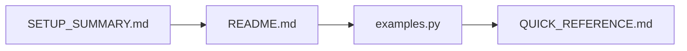

# 📚 Índice de Documentação - Agent Server para Escala

## 🎯 Começar Aqui

1. **[SETUP_SUMMARY.md](SETUP_SUMMARY.md)** ⭐ **COMECE AQUI**
   - Resumo completo do que foi criado
   - Próximos passos
   - Cenários de uso

## 📖 Documentação Principal

### Configuração e Escala

2. **[AGENT_SERVER_SCALE_CONFIG.md](AGENT_SERVER_SCALE_CONFIG.md)**
   - 📊 Análise de carga (read/write)
   - ⚙️ Melhores práticas de performance
   - 🚀 Configurações por cenário (baixa, média, alta)
   - 📈 Cálculos de capacidade
   - 🎯 Otimizações específicas

### Deployment

3. **[DEPLOYMENT_CHECKLIST.md](DEPLOYMENT_CHECKLIST.md)**
   - ✅ Checklist de 20 etapas
   - 🔍 Validações antes/durante/após deploy
   - 🧪 Testes de carga
   - 🆘 Troubleshooting

### Referência Rápida

4. **[QUICK_REFERENCE.md](QUICK_REFERENCE.md)**
   - 💻 Comandos úteis
   - 📝 Operações comuns (threads, runs, assistants)
   - 📊 Monitoramento
   - 🐛 Debug e troubleshooting
   - 🔧 Padrões de uso

### Arquitetura

5. **[ARCHITECTURE_DIAGRAM.md](ARCHITECTURE_DIAGRAM.md)**
   - 🏗️ Diagramas de arquitetura
   - 🔄 Fluxos de requisição
   - 📦 Componentes e responsabilidades
   - 💰 Custos estimados

### Recursos Avançados

6. **[DOUBLE_TEXTING_GUIDE.md](DOUBLE_TEXTING_GUIDE.md)** 🆕
   - 🔄 Estratégias de multitasking
   - ⚡ Enqueue, Reject, Interrupt, Rollback
   - 📊 Casos de uso práticos
   - 💡 Melhores práticas

7. **[STUDIO_GUIDE.md](STUDIO_GUIDE.md)** 🆕
   - 🎨 Visão completa do Studio
   - 🔍 Debugging e time travel
   - 📊 Experimentos e avaliações
   - 🎯 Iteração de prompts

8. **[ADVANCED_CUSTOMIZATION_GUIDE.md](ADVANCED_CUSTOMIZATION_GUIDE.md)** 🆕
   - 📍 Rotas customizadas
   - 🛡️ Middleware personalizado
   - ♻️ Lifespan events
   - 🔧 Integrações avançadas

### README

9. **[README.md](README.md)**
   - 📋 Visão geral do projeto
   - 🚀 Instalação e execução
   - 🤖 Descrição dos 16 agentes
   - 📁 Estrutura do projeto

## 🛠️ Arquivos de Configuração

### Produção

7. **[deployment-config.yaml](streamlit-app/deployment-config.yaml)**
   - Configuração otimizada para carga média (50 req/s)
   - 3 API servers
   - 5 Queue workers
   - 25 jobs/worker
   - PostgreSQL e Redis dimensionados
   - Autoscaling configurável
   - Monitoramento e alertas

8. **[.env.production](streamlit-app/.env.production)**
   - Template de variáveis de ambiente
   - Performance settings
   - Database connections
   - API keys
   - Security settings

### Desenvolvimento

9. **[langgraph.json](streamlit-app/langgraph.json)**
   - Configuração do LangGraph
   - Schema do grafo
   - TTL de checkpoints
   - Configuração de store

## 🔧 Scripts Úteis

### Monitoramento

10. **[monitor_metrics.py](streamlit-app/scripts/monitor_metrics.py)**
    ```bash
    # Executar uma vez
    python scripts/monitor_metrics.py

    # Monitoramento contínuo
    python scripts/monitor_metrics.py --continuous 60
    ```
    - 🏥 Health checks
    - 📊 Métricas de runs (latência, sucesso)
    - 🧵 Métricas de threads
    - 🔔 Alertas automáticos

### Planejamento

11. **[calculate_capacity.py](streamlit-app/scripts/calculate_capacity.py)**
    ```bash
    python scripts/calculate_capacity.py
    ```
    - 📊 Calcula recursos necessários
    - 🎯 Cenários pré-definidos
    - ✏️ Cenário personalizado
    - 📄 Gera YAML de configuração

### Exemplos

12. **[examples.py](streamlit-app/scripts/examples.py)**
    ```bash
    python scripts/examples.py
    ```
    - 💬 Conversação com memória
    - ⚡ Processamento em batch
    - ⏰ Cron jobs
    - 🌊 Streaming de tokens
    - ⏮️ Time travel
    - 📊 Monitoramento
    - 🎨 Assistants customizados

## 📊 Guias por Caso de Uso

### Para Desenvolvedores

**Primeiros passos:**
1. [SETUP_SUMMARY.md](SETUP_SUMMARY.md) - Visão geral
2. [README.md](README.md) - Instalação
3. [examples.py](streamlit-app/scripts/examples.py) - Exemplos práticos
4. [QUICK_REFERENCE.md](QUICK_REFERENCE.md) - Comandos úteis

### Para DevOps/SRE

**Deploy e operação:**
1. [AGENT_SERVER_SCALE_CONFIG.md](AGENT_SERVER_SCALE_CONFIG.md) - Entender escala
2. [calculate_capacity.py](streamlit-app/scripts/calculate_capacity.py) - Calcular recursos
3. [DEPLOYMENT_CHECKLIST.md](DEPLOYMENT_CHECKLIST.md) - Seguir checklist
4. [deployment-config.yaml](streamlit-app/deployment-config.yaml) - Aplicar configuração
5. [monitor_metrics.py](streamlit-app/scripts/monitor_metrics.py) - Monitorar

### Para Arquitetos

**Design e planejamento:**
1. [ARCHITECTURE_DIAGRAM.md](ARCHITECTURE_DIAGRAM.md) - Entender arquitetura
2. [AGENT_SERVER_SCALE_CONFIG.md](AGENT_SERVER_SCALE_CONFIG.md) - Opções de escala
3. [deployment-config.yaml](streamlit-app/deployment-config.yaml) - Configurações possíveis

## 🎓 Fluxo de Aprendizado Recomendado

### Nível Iniciante



1. Ler o resumo geral
2. Instalar e rodar localmente
3. Executar exemplos práticos
4. Consultar referência rápida

### Nível Intermediário


1. Entender conceitos de escala
2. Calcular capacidade necessária
3. Configurar deployment
4. Testar em staging

### Nível Avançado


1. Estudar arquitetura completa
2. Seguir checklist de produção
3. Configurar monitoramento
4. Deploy em produção

## 📋 Checklist Rápido por Etapa

### ✅ Etapa 1: Setup Inicial (30 min)

- [ ] Ler [SETUP_SUMMARY.md](SETUP_SUMMARY.md)
- [ ] Instalar dependências (README.md)
- [ ] Executar `langgraph dev`
- [ ] Testar com [examples.py](streamlit-app/scripts/examples.py)

### ✅ Etapa 2: Planejamento (1h)

- [ ] Ler [AGENT_SERVER_SCALE_CONFIG.md](AGENT_SERVER_SCALE_CONFIG.md)
- [ ] Executar [calculate_capacity.py](streamlit-app/scripts/calculate_capacity.py)
- [ ] Definir cenário de carga
- [ ] Escolher opção de deployment

### ✅ Etapa 3: Configuração (2h)

- [ ] Copiar [.env.production](streamlit-app/.env.production) para `.env`
- [ ] Configurar variáveis de ambiente
- [ ] Provisionar PostgreSQL externo
- [ ] Provisionar Redis externo
- [ ] Ajustar [deployment-config.yaml](streamlit-app/deployment-config.yaml)

### ✅ Etapa 4: Deploy Staging (1h)

- [ ] Seguir [DEPLOYMENT_CHECKLIST.md](DEPLOYMENT_CHECKLIST.md)
- [ ] Deploy em ambiente de teste
- [ ] Executar testes básicos
- [ ] Configurar [monitor_metrics.py](streamlit-app/scripts/monitor_metrics.py)

### ✅ Etapa 5: Validação (1 semana)

- [ ] Monitorar métricas continuamente
- [ ] Executar testes de carga graduais
- [ ] Coletar feedback
- [ ] Ajustar configurações conforme necessário

### ✅ Etapa 6: Deploy Produção (2h)

- [ ] Revisar checklist completo
- [ ] Deploy em produção
- [ ] Configurar alertas
- [ ] Documentar runbook de operações

## 🔍 Busca Rápida

### Por Tópico

- **Performance**: [AGENT_SERVER_SCALE_CONFIG.md](AGENT_SERVER_SCALE_CONFIG.md)
- **Deployment**: [DEPLOYMENT_CHECKLIST.md](DEPLOYMENT_CHECKLIST.md)
- **Comandos**: [QUICK_REFERENCE.md](QUICK_REFERENCE.md)
- **Arquitetura**: [ARCHITECTURE_DIAGRAM.md](ARCHITECTURE_DIAGRAM.md)
- **Custos**: [ARCHITECTURE_DIAGRAM.md](ARCHITECTURE_DIAGRAM.md#custos-estimados-mensal)
- **Monitoramento**: [monitor_metrics.py](streamlit-app/scripts/monitor_metrics.py)

### Por Problema

- **Runs lentos**: [AGENT_SERVER_SCALE_CONFIG.md > Troubleshooting](AGENT_SERVER_SCALE_CONFIG.md#troubleshooting)
- **Erros frequentes**: [DEPLOYMENT_CHECKLIST.md > Troubleshooting](DEPLOYMENT_CHECKLIST.md#troubleshooting)
- **Alto uso de recursos**: [QUICK_REFERENCE.md > Troubleshooting](QUICK_REFERENCE.md#troubleshooting)
- **Deployment falhou**: [DEPLOYMENT_CHECKLIST.md](DEPLOYMENT_CHECKLIST.md)

## 📞 Suporte

### Documentação Oficial

- 📚 [LangSmith Docs](https://docs.langchain.com/langsmith)
- 📚 [LangGraph Docs](https://docs.langchain.com/oss/python/langgraph)
- 📚 [API Reference](https://api.smith.langchain.com/redoc)

### Comunidade

- 💬 [Discord LangChain](https://discord.gg/langchain)
- 📧 [Support Email](mailto:support@langchain.com)
- 🐛 [GitHub Issues](https://github.com/langchain-ai/langchain/issues)

## 🎯 Objetivos por Documento

| Documento | Objetivo | Quando Usar |
|-----------|----------|-------------|
| **SETUP_SUMMARY** | Visão geral | Começar |
| **AGENT_SERVER_SCALE_CONFIG** | Entender escala | Planejar |
| **DEPLOYMENT_CHECKLIST** | Deploy seguro | Deploying |
| **QUICK_REFERENCE** | Consulta rápida | Dia a dia |
| **ARCHITECTURE_DIAGRAM** | Entender design | Arquitetar |
| **deployment-config.yaml** | Configurar infra | Configurar |
| **monitor_metrics.py** | Observar sistema | Monitorar |
| **calculate_capacity.py** | Dimensionar | Planejar |
| **examples.py** | Aprender API | Desenvolver |

## 🚀 Atalhos Úteis

```bash
# Ver resumo
cat SETUP_SUMMARY.md

# Calcular capacidade
python scripts/calculate_capacity.py

# Monitorar (contínuo)
python scripts/monitor_metrics.py --continuous 60

# Testar localmente
langgraph dev

# Ver exemplos
python scripts/examples.py
```

---

**Última atualização**: 30 de dezembro de 2025
**Versão**: 1.0
**Mantido por**: Equipe de Desenvolvimento
