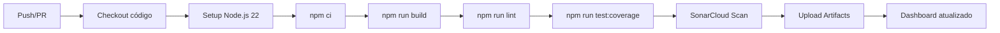

# 📊 SonarCloud Setup - Assistente Jurídico PJe

> **Análise automática de qualidade de código e cobertura de testes integrada ao GitHub Actions**

[](https://sonarcloud.io/summary/new_code?id=thiagobodevan-a11y_assistente-juridico-p)
[](https://sonarcloud.io/summary/new_code?id=thiagobodevan-a11y_assistente-juridico-p)
[](https://sonarcloud.io/summary/new_code?id=thiagobodevan-a11y_assistente-juridico-p)
[](https://sonarcloud.io/summary/new_code?id=thiagobodevan-a11y_assistente-juridico-p)

---

## 📋 Índice

- [Visão Geral](#-visão-geral)
- [Configuração Inicial](#-configuração-inicial)
- [Como Usar](#-como-usar)
- [Métricas e Badges](#-métricas-e-badges)
- [Troubleshooting](#-troubleshooting)
- [Referências](#-referências)

---

## 🎯 Visão Geral

Este projeto está configurado com **SonarCloud** para análise contínua de qualidade de código. A integração inclui:

- ✅ **Análise automática** a cada push/PR nas branches `main` e `develop`
- ✅ **Cobertura de testes** (Vitest com provider v8)
- ✅ **Build e Lint** antes da análise (detecta erros cedo)
- ✅ **Relatórios visuais** no dashboard do SonarCloud
- ✅ **Badges** para README.md
- ✅ **GitHub Actions** workflow automatizado

### 🔗 Links Importantes

| Recurso | URL |
|---------|-----|
| **Dashboard SonarCloud** | https://sonarcloud.io/summary/overall?id=thiagobodevan-a11y_assistente-juridico-p |
| **GitHub Actions** | https://github.com/thiagobodevan-a11y/assistente-juridico-p/actions/workflows/sonarcloud.yml |
| **Organização** | https://sonarcloud.io/organizations/thiagobodevan-a11y |

---

## 🚀 Configuração Inicial

### 1️⃣ Pré-requisitos

- [x] Conta no [SonarCloud](https://sonarcloud.io/)
- [x] Organização criada (`thiagobodevan-a11y`)
- [x] Projeto importado do GitHub
- [x] Token de acesso gerado

### 2️⃣ Token no GitHub Secrets

O token `SONAR_TOKEN` já está configurado como **GitHub Secret**:

```bash
# Verificar se o secret existe (via GitHub UI)
# Settings → Secrets and variables → Actions → Repository secrets
# Nome: SONAR_TOKEN
# Valor: e04da699455ce47ef8caa0cced5d7b9c29c058d0
```

> ⚠️ **Nunca exponha o token em commits ou logs públicos!**

### 3️⃣ Arquivos de Configuração

#### `.github/workflows/sonarcloud.yml` (Workflow CI/CD)

```yaml
name: SonarCloud Analysis

on:
  push:
    branches: [main, develop]
  pull_request:
    types: [opened, synchronize, reopened]

jobs:
  sonarcloud:
    name: SonarCloud Scan with Coverage
    runs-on: ubuntu-latest
    
    steps:
      - name: Checkout code
        uses: actions/checkout@v4
        with:
          fetch-depth: 0  # Necessário para análise de histórico

      - name: Setup Node.js 22
        uses: actions/setup-node@v4
        with:
          node-version: '22'
          cache: 'npm'

      - name: Install dependencies
        run: npm ci

      - name: Build project
        run: npm run build

      - name: Lint code
        run: npm run lint

      - name: Run tests with coverage
        run: npm run test:coverage

      - name: SonarCloud Scan
        uses: SonarSource/sonarcloud-github-action@master
        env:
          GITHUB_TOKEN: ${{ secrets.GITHUB_TOKEN }}
          SONAR_TOKEN: ${{ secrets.SONAR_TOKEN }}

      - name: Upload coverage report
        uses: actions/upload-artifact@v4
        if: always()
        with:
          name: coverage-report
          path: coverage-api/
          retention-days: 30
```

#### `sonar-project.properties` (Configuração do SonarQube)

```properties
sonar.projectKey=thiagobodevan-a11y_assistente-juridico-p
sonar.organization=thiagobodevan-a11y

# Project info
sonar.projectName=Assistente Jurídico PJe
sonar.projectVersion=1.0.0

# Source code location
sonar.sources=src,api
sonar.tests=src
sonar.test.inclusions=**/*.test.ts,**/*.test.tsx,**/*.spec.ts,**/*.spec.tsx

# Exclusions
sonar.exclusions=**/node_modules/**,**/dist/**,**/*.test.ts,**/*.test.tsx,**/*.spec.ts,**/*.spec.tsx,**/coverage/**,**/__mocks__/**

# TypeScript/JavaScript configuration
sonar.typescript.tsconfigPath=tsconfig.json
sonar.javascript.lcov.reportPaths=coverage-api/lcov.info
sonar.typescript.lcov.reportPaths=coverage-api/lcov.info
sonar.testExecutionReportPaths=coverage-api/test-report.xml
sonar.coverage.exclusions=**/*.test.ts,**/*.test.tsx,**/*.spec.ts,**/*.spec.tsx,**/test/**,**/*.config.ts,**/*.config.js

# Language configuration
sonar.language=ts,js
sonar.javascript.file.suffixes=.js,.jsx
sonar.typescript.file.suffixes=.ts,.tsx

# SCM and links
sonar.links.homepage=https://github.com/thiagobodevan-a11y/assistente-juridico-p
sonar.links.ci=https://github.com/thiagobodevan-a11y/assistente-juridico-p/actions
sonar.links.scm=https://github.com/thiagobodevan-a11y/assistente-juridico-p
sonar.links.issue=https://github.com/thiagobodevan-a11y/assistente-juridico-p/issues

# Encoding
sonar.sourceEncoding=UTF-8
```

#### `vite.config.ts` (Configuração de Cobertura)

```typescript
export default defineConfig({
  test: {
    coverage: {
      provider: 'v8',
      reporter: ['text', 'json', 'html', 'lcov'],
      reportsDirectory: './coverage-api',
      exclude: [
        'node_modules/',
        'dist/',
        'tests/',
        '*.config.ts',
        '*.config.js',
        '**/__mocks__/**',
        '**/types.ts',
      ],
    },
  },
})
```

#### `.gitignore` (Excluir arquivos do SonarCloud)

```ignore
# SonarQube/SonarCloud (temp directories)
.scannerwork/
.sonar/

# Test coverage
coverage/
coverage-api/
*.lcov
```

---

## 💡 Como Usar

### 📊 Executar Análise Localmente (Opcional)

1️⃣ **Instalar SonarScanner CLI** (opcional para testes locais):

```bash
# Alpine Linux (Codespaces)
apk add --no-cache sonar-scanner-cli

# macOS
brew install sonar-scanner

# Linux (via download)
wget https://binaries.sonarsource.com/Distribution/sonar-scanner-cli/sonar-scanner-cli-5.0.1.3006-linux.zip
unzip sonar-scanner-cli-5.0.1.3006-linux.zip
export PATH=$PATH:$(pwd)/sonar-scanner-5.0.1.3006-linux/bin
```

2️⃣ **Executar testes com cobertura**:

```bash
npm run test:coverage
```

3️⃣ **Executar análise SonarCloud** (requer token):

```bash
sonar-scanner \
  -Dsonar.token=e04da699455ce47ef8caa0cced5d7b9c29c058d0 \
  -Dsonar.host.url=https://sonarcloud.io
```

> ⚠️ **Nota**: A análise automática via GitHub Actions é a forma recomendada (não requer instalação local).

### 🔄 Análise Automática (GitHub Actions)

A análise roda **automaticamente** quando você:

1. **Push para `main` ou `develop`**:
   ```bash
   git add .
   git commit -m "feat: nova feature"
   git push origin main
   ```

2. **Abre/Atualiza Pull Request**:
   - O workflow roda em PRs para branches protegidas
   - Resultados aparecem como checks no PR

3. **Verificar resultados**:
   - **GitHub Actions**: https://github.com/thiagobodevan-a11y/assistente-juridico-p/actions
   - **Dashboard SonarCloud**: https://sonarcloud.io/summary/overall?id=thiagobodevan-a11y_assistente-juridico-p

### 📈 Workflow Completo (o que acontece em cada execução)



1. **Checkout**: Clona o repositório com histórico completo
2. **Setup Node.js**: Configura Node.js 22 com cache npm
3. **Install Dependencies**: Instala pacotes via `npm ci`
4. **Build**: Compila TypeScript e gera bundle Vite
5. **Lint**: Verifica erros de linting (ESLint 9)
6. **Test Coverage**: Executa testes com Vitest e gera LCOV
7. **SonarCloud Scan**: Envia código e cobertura para análise
8. **Upload Artifacts**: Salva relatórios de cobertura por 30 dias

---

## 🏆 Métricas e Badges

### 📍 Badges Disponíveis

Adicione ao `README.md`:

```markdown
[](https://sonarcloud.io/summary/new_code?id=thiagobodevan-a11y_assistente-juridico-p)
[](https://sonarcloud.io/summary/new_code?id=thiagobodevan-a11y_assistente-juridico-p)
[](https://sonarcloud.io/summary/new_code?id=thiagobodevan-a11y_assistente-juridico-p)
[](https://sonarcloud.io/summary/new_code?id=thiagobodevan-a11y_assistente-juridico-p)
[](https://sonarcloud.io/summary/new_code?id=thiagobodevan-a11y_assistente-juridico-p)
[](https://sonarcloud.io/summary/new_code?id=thiagobodevan-a11y_assistente-juridico-p)
[](https://sonarcloud.io/summary/new_code?id=thiagobodevan-a11y_assistente-juridico-p)
```

### 📊 Métricas Principais

| Métrica | Descrição |
|---------|-----------|
| **Quality Gate** | Status geral (Passed/Failed) |
| **Coverage** | % de código coberto por testes |
| **Bugs** | Erros de lógica detectados |
| **Vulnerabilities** | Falhas de segurança |
| **Code Smells** | Problemas de manutenibilidade |
| **Technical Debt** | Tempo estimado para corrigir issues |
| **Duplications** | % de código duplicado |

---

## 🔧 Troubleshooting

### ❌ Problema: "SONAR_TOKEN is not set"

**Causa**: Secret não configurado no GitHub.

**Solução**:
1. Acesse: `Settings → Secrets and variables → Actions`
2. Clique em `New repository secret`
3. Nome: `SONAR_TOKEN`
4. Valor: `e04da699455ce47ef8caa0cced5d7b9c29c058d0`
5. Salve e re-execute o workflow

### ❌ Problema: "No coverage report found"

**Causa**: Testes não geraram `coverage-api/lcov.info`.

**Solução**:
```bash
# 1. Verificar se Vitest está instalado
npm list vitest @vitest/coverage-v8

# 2. Executar testes localmente
npm run test:coverage

# 3. Verificar se o arquivo foi gerado
ls -la coverage-api/lcov.info

# 4. Verificar vite.config.ts tem coverage configurado
grep -A 10 "coverage:" vite.config.ts
```

### ❌ Problema: "Build failed" no workflow

**Causa**: Erros de compilação TypeScript ou Vite.

**Solução**:
```bash
# 1. Testar build localmente
npm run build

# 2. Se falhar, verificar erros TypeScript
npx tsc --noEmit

# 3. Corrigir erros antes de commit
```

### ❌ Problema: "Lint errors detected"

**Causa**: ESLint encontrou erros (workflow configurado para falhar em erros de lint).

**Solução**:
```bash
# 1. Verificar erros localmente
npm run lint

# 2. Auto-fix quando possível
npm run lint -- --fix

# 3. Corrigir erros manualmente restantes
```

### ❌ Problema: "Quality Gate Failed"

**Causa**: Código não passa nos critérios de qualidade do SonarCloud.

**Solução**:
1. Acesse: https://sonarcloud.io/summary/overall?id=thiagobodevan-a11y_assistente-juridico-p
2. Veja a aba "Issues" para listar problemas
3. Corrija os issues críticos/altos
4. Melhore cobertura de testes se < 80%

### ❌ Problema: ".scannerwork/ commitado por engano"

**Causa**: Diretório temporário do SonarCloud não está no `.gitignore`.

**Solução**:
```bash
# 1. Remover do Git
git rm -r --cached .scannerwork/ .sonar/

# 2. Verificar se está no .gitignore
grep -E "scannerwork|\.sonar" .gitignore

# 3. Commit da correção
git add .gitignore
git commit -m "fix: adiciona .scannerwork/ e .sonar/ ao .gitignore"
```

### ⚠️ Problema: "Workflow timeout"

**Causa**: Testes ou build demorando mais de 60 minutos (limite GitHub Actions).

**Solução**:
1. Otimize testes (remover `console.log`, mock APIs externas)
2. Reduza dependências no build
3. Use cache do npm (já configurado em `setup-node@v4`)

---

## 📚 Referências

### 🔗 Documentação Oficial

- [SonarCloud Docs](https://docs.sonarcloud.io/)
- [SonarCloud GitHub Action](https://github.com/SonarSource/sonarcloud-github-action)
- [SonarScanner CLI](https://docs.sonarcloud.io/advanced-setup/ci-based-analysis/sonarscanner-cli/)
- [Análise TypeScript](https://docs.sonarcloud.io/enriching/test-coverage/typescript/)

### 📖 Guias Relacionados

| Documento | Descrição |
|-----------|-----------|
| `README.md` | Setup geral do projeto |
| `SECURITY.md` | Políticas de segurança |
| `MONITORING_SETUP.md` | Configuração de monitoramento |
| `.github/copilot-instructions.md` | Instruções do Copilot |

### 🛠️ Ferramentas Integradas

- **GitHub Actions**: CI/CD automático
- **Vitest**: Framework de testes
- **@vitest/coverage-v8**: Provider de cobertura
- **ESLint 9**: Linting com flat config
- **TypeScript 5.5**: Tipagem estática
- **Vite 6**: Build tool

---

## 🎯 Checklist de Configuração

Use este checklist para verificar se tudo está configurado corretamente:

- [x] Projeto importado no SonarCloud
- [x] Token `SONAR_TOKEN` configurado no GitHub Secrets
- [x] `sonar-project.properties` criado e configurado
- [x] `.github/workflows/sonarcloud.yml` criado
- [x] `vite.config.ts` com coverage configurado
- [x] `.gitignore` com `.scannerwork/` e `.sonar/`
- [x] Workflow executa em push/PR
- [x] Build e lint passando
- [x] Testes gerando `coverage-api/lcov.info`
- [x] Dashboard SonarCloud acessível
- [x] Badges adicionados ao README (opcional)

---

## 🤝 Contribuindo

Para contribuir com melhorias na configuração do SonarCloud:

1. **Crie issue**: Descreva o problema ou sugestão
2. **Teste localmente**: Valide mudanças antes de commit
3. **Abra PR**: Com descrição clara das alterações
4. **Aguarde análise**: Workflow roda automaticamente no PR

---

## 📝 Changelog de Configuração

| Data | Versão | Mudança |
|------|--------|---------|
| 2024-01-XX | 1.0.0 | Setup inicial com GitHub Actions |
| 2024-01-XX | 1.1.0 | Adicionado build/lint antes dos testes |
| 2024-01-XX | 1.2.0 | Configuração de linguagens e links SCM |

---

## 📞 Suporte

Problemas com SonarCloud? Entre em contato:

- **Issues GitHub**: https://github.com/thiagobodevan-a11y/assistente-juridico-p/issues
- **SonarCloud Community**: https://community.sonarsource.com/
- **Documentação**: https://docs.sonarcloud.io/

---

**Última atualização**: Janeiro 2024  
**Versão**: 1.2.0  
**Mantido por**: [@thiagobodevan-a11y](https://github.com/thiagobodevan-a11y)
