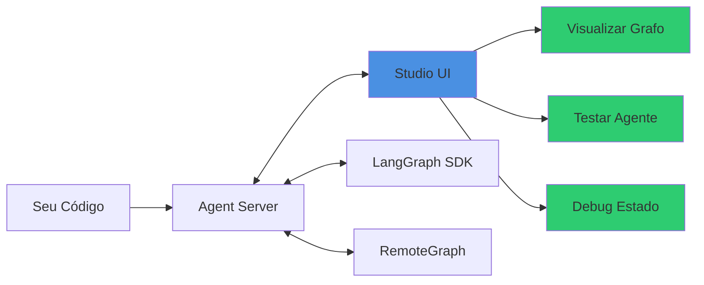

# 🎨 LangSmith Studio - Guia Completo

## O que é o Studio?

**LangSmith Studio** é um IDE especializado para agentes que permite visualizar, interagir e debugar sistemas agenticos que implementam o protocolo Agent Server API.



## 🎯 Principais Recursos

### 1. Visualização do Grafo

```
┌─────────────────────────────────────────┐
│                                         │
│   ┌──────┐    ┌──────┐    ┌──────┐    │
│   │START │───▶│Node A│───▶│Node B│    │
│   └──────┘    └──────┘    └──────┘    │
│                   │                     │
│                   ▼                     │
│               ┌──────┐                  │
│               │Node C│                  │
│               └──────┘                  │
│                   │                     │
│                   ▼                     │
│               ┌──────┐                  │
│               │ END  │                  │
│               └──────┘                  │
│                                         │
└─────────────────────────────────────────┘
```

### 2. Modos de Uso

Studio oferece 2 modos:

#### Modo Graph (Completo) 📊

- Visualização completa do grafo
- Histórico de execução detalhado
- Estados intermediários
- Time travel e debugging
- Integrações LangSmith (datasets, playground)

**Quando usar:** Desenvolvimento, debugging, análise detalhada

#### Modo Chat (Simples) 💬

- Interface de chat simplificada
- Ideal para testes rápidos
- Menos detalhes técnicos
- Foco na experiência do usuário

**Quando usar:** Testes de usuário final, demos, validação de comportamento

**⚠️ Requisito:** Estado do grafo deve incluir ou estender [`MessagesState`](https://langchain-ai.github.io/langgraph/reference/graphs/#langgraph.graph.message.MessagesState)

---

## 🚀 Começando

### Opção 1: Local (Desenvolvimento)

```bash
# Iniciar servidor de desenvolvimento
cd streamlit-app
langgraph dev

# Studio abre automaticamente em:
# http://localhost:2024/studio
```

### Opção 2: Cloud (Produção)

```bash
# Deploy no LangSmith
# Acesse: https://smith.langchain.com
# Navegue para: Deployments > [Seu Deploy] > Studio
```

### Opção 3: Self-Hosted

```bash
# Configurar no deployment-config.yaml
# Studio estará disponível em: <DEPLOYMENT_URL>/studio
```

---

## 📋 Como Usar o Studio

### 1. Executar seu Agente

#### Modo Graph

**Especificar Input:**

1. Defina o input na seção **Input** (lado esquerdo)
2. Studio renderiza formulário baseado no schema do grafo
3. Clique **View Raw** para editar JSON diretamente

```json
// Exemplo de input
{
  "messages": [
    {
      "role": "user",
      "content": "Analise este contrato de prestação de serviços"
    }
  ]
}
```

**Configurações de Run:**

```python
# Selecionar assistant
1. Clicar "Settings" (canto inferior esquerdo)
2. Escolher o assistant
3. Ativar com toggle "Active"

# Habilitar streaming
1. Clicar dropdown ao lado de "Submit"
2. Toggle streaming on/off

# Adicionar breakpoints
1. Clicar "Interrupt"
2. Selecionar nó e before/after
3. Clicar "Continue" para retomar
```

**Submeter Run:**
1. Clicar **Submit**
2. Para cancelar: clicar **Cancel**

#### Modo Chat

1. Digite mensagem no campo inferior
2. Clique **Send message**
3. Resposta é streaming em tempo real
4. Toggle **Show tool calls** para mostrar/ocultar chamadas de ferramentas

---

### 2. Gerenciar Assistants

Os [assistants](/langsmith/assistants) permitem diferentes configurações do mesmo grafo.

#### Modo Graph

```python
# Ver assistants
1. Clicar "Manage Assistants" (canto inferior esquerdo)
2. Ver todos os assistants do grafo
3. Selecionar assistant e versão como "Active"

# Configuração padrão
- "Default configuration" = config do grafo
- Edições afetam runtime config
- Para criar novo assistant: clicar "Create new assistant"
```

**Exemplo: Criar Assistant Personalizado**

```python
from langgraph_sdk import get_client

client = get_client(url="<DEPLOYMENT_URL>")

# Criar assistant especializado
trabalhista_assistant = await client.assistants.create(
    "legal_assistant",
    name="Assistente Trabalhista",
    context={
        "temperature": 0.3,
        "specialization": "direito_trabalhista",
        "system_prompt": "Você é especialista em direito trabalhista brasileiro"
    }
)
```

#### Modo Chat

- Trocar assistants via dropdown no topo
- Para criar/editar: usar Modo Graph

---

### 3. Gerenciar Threads

[Threads](/oss/python/langgraph/persistence#threads) mantêm o histórico de conversação.

#### Modo Graph

**Ver Threads:**

```python
# No Studio
1. Dropdown no topo do painel direito
2. Selecionar thread desejado
3. Histórico aparece no lado direito

# Criar novo thread
1. Clicar "+ New Thread"
2. Submeter um run

# Visualização
- Arrastar slider para mais/menos detalhes
- Expandir/colapsar turns, nodes, keys
- Alternar entre modo Pretty e JSON
```

**Editar Estado do Thread:**

```python
# Time Travel
1. Selecionar 📝 "Edit node state" ao lado do nó
2. Editar output do nó
3. Clicar "Fork" para criar fork do checkpoint

# Re-run
1. Selecionar checkpoint
2. Clicar "Re-run from here"
3. Nova fork é criada
```

**Exemplo: Time Travel Manual**

```python
# Via SDK (para automação)
from langgraph_sdk import get_client

client = get_client(url="<DEPLOYMENT_URL>")

# Ver histórico
history = await client.threads.get_history(thread_id)

# Voltar para checkpoint anterior
checkpoint = history[1]  # Segundo checkpoint
new_config = await client.threads.update_state(
    thread_id,
    {"messages": [{"role": "user", "content": "Refazer análise"}]},
    checkpoint_id=checkpoint["checkpoint_id"]
)

# Continuar execução
result = await client.runs.wait(
    thread_id,
    "legal_assistant",
    input=None,
    checkpoint_id=new_config["checkpoint_id"]
)
```

#### Modo Chat

```python
# Ver threads
- Painel direito mostra todos os threads
- Clicar para selecionar
- Histórico aparece no centro

# Criar novo
- Clicar "+"
- Submeter mensagem

# Editar
- Clicar 📝 abaixo da mensagem humana
- Editar e submeter = nova fork
- Clicar retry abaixo da mensagem AI para regenerar
```

---

## 🔍 Recursos Avançados de Observabilidade

### 1. Iterar em Prompts

Studio permite modificar prompts de duas formas:

#### Edição Direta de Nós

**Configurar no Código:**

```python
from pydantic import BaseModel, Field
from typing import Literal, Annotated

class Configuration(BaseModel):
    """Configuração do assistente"""

    system_prompt: str = Field(
        default="Você é um assistente jurídico especializado.",
        description="Prompt do sistema para o assistente",
        json_schema_extra={
            "langgraph_nodes": ["call_model"],  # Associar a nós
            "langgraph_type": "prompt",         # Tipo prompt
        },
    )

    model: Annotated[
        Literal["gpt-4o", "claude-3-5-sonnet", "gemini-pro"],
        {"__template_metadata__": {"kind": "llm"}},
    ] = Field(
        default="gpt-4o",
        description="Modelo LLM a usar",
        json_schema_extra={"langgraph_nodes": ["call_model"]},
    )
```

**Uso no Studio:**
1. Ícone de engrenagem aparece em nós com configuração
2. Clicar para abrir modal
3. Editar valores
4. Salvar para atualizar assistant

#### Via Playground

```python
# Processo
1. Selecionar thread
2. Clicar "View LLM Runs" em um nó
3. Selecionar uma LLM run para abrir no playground
4. Modificar prompt, modelo, ferramentas
5. Testar mudanças
6. Copiar prompt atualizado para o grafo
```

---

### 2. Executar Experimentos

Run [evaluations](/langsmith/evaluation-concepts) contra [datasets](/langsmith/evaluation-concepts#datasets).

**Pré-requisitos:**
- Dataset LangSmith com inputs compatíveis
- (Opcional) Evaluators configurados
- Aplicação rodando (deployed ou local)

**Passos:**

```python
# No Studio
1. Clicar "Run experiment" (canto superior direito)
2. Selecionar dataset (ou split)
3. Clicar "Start"
4. Monitorar progresso via badge no topo
5. Clicar seta para ver resultados no LangSmith
```

**Via SDK (Programático):**

```python
from langgraph_sdk import get_client

client = get_client(url="<DEPLOYMENT_URL>")

# Criar experiment
experiment = await client.experiments.create(
    dataset_id="dataset-123",
    assistant_id="legal_assistant",
    config={
        "temperature": 0.5
    }
)

# Aguardar conclusão
await client.experiments.wait(experiment["id"])

# Ver resultados
results = await client.experiments.get_results(experiment["id"])
print(f"Taxa de sucesso: {results['success_rate']}%")
```

---

### 3. Debugar Traces do LangSmith

Importar traces para Studio para investigação interativa.

**Opção 1: Abrir Threads Deployed**

```python
# Via LangSmith UI
1. Abrir trace no LangSmith
2. Selecionar root run
3. Clicar "Run in Studio"

# Abre Studio com deployment e thread associado
```

**Opção 2: Testar Agent Local com Traces Remotos**

```python
# Requisitos
- langgraph>=0.3.18
- langgraph-api>=0.0.32
- Agent local com mesmos nós do trace remoto

# Processo
1. Abrir trace no LangSmith
2. Clicar dropdown ao lado de "Run in Studio"
3. Entrar URL do agent local
4. Selecionar "Clone thread locally"
5. Se múltiplos grafos: selecionar alvo

# Resultado: Thread clonado no agent local
```

**Uso Prático:**

```bash
# Terminal 1: Iniciar agent local
cd streamlit-app
langgraph dev

# Terminal 2: Obter URL do agent
echo "Agent rodando em: http://localhost:2024"

# No LangSmith UI:
# - Abrir trace de produção
# - Run in Studio > Clone thread locally
# - URL: http://localhost:2024
```

---

### 4. Adicionar Nós a Datasets

Criar [examples](/langsmith/evaluation-concepts#examples) de nós específicos.

```python
# No Studio
1. Selecionar thread
2. Clicar "Add to Dataset"
3. Selecionar nós cujo input/output quer adicionar
4. Para cada nó: selecionar dataset alvo
5. Editar input/output conforme necessário
6. Clicar "Add to dataset" no rodapé

# Datasets são criados automaticamente se não existirem
# Naming: {assistant_name}_{node_name}_dataset
```

**Exemplo de Dataset Gerado:**

```json
// Dataset: legal_assistant_analise_contrato_dataset
{
  "examples": [
    {
      "input": {
        "documento": "contrato_servicos.pdf",
        "tipo": "prestacao_servicos"
      },
      "output": {
        "analise": "Contrato válido com cláusulas padrão...",
        "riscos": ["Falta cláusula de rescisão..."],
        "score": 8.5
      },
      "metadata": {
        "thread_id": "thread-123",
        "checkpoint_id": "checkpoint-456"
      }
    }
  ]
}
```

---

## 🔧 Troubleshooting

### Safari: "Failed to load assistants"

**Problema:** Safari bloqueia HTTP em localhost

**Soluções:**

```bash
# Opção 1: Cloudflare Tunnel
pip install -U langgraph-cli>=0.2.6
langgraph dev --tunnel

# Use URL gerada:
# https://smith.langchain.com/studio/?baseUrl=https://xxx.trycloudflare.com

# Opção 2: Usar Chrome/Brave
```

### Chrome 142+: "Failed to initialize Studio"

**Problema:** Private Network Access bloqueado

**Solução:**

```
1. Abrir https://smith.langchain.com em Chrome
2. Clicar ícone de cadeado na barra de endereço
3. Procurar "Local network access"
4. Mudar de "Ask (default)" para "Allow"
5. Recarregar página
```

### Brave: Shields bloqueando

**Solução:**

```
1. Desabilitar Brave Shields para LangSmith
   (ícone Brave na URL bar)

2. Ou usar Cloudflare Tunnel:
   langgraph dev --tunnel
```

### Edges Indefinidos no Grafo

**Problema:** Conditional edges mostram conexões inesperadas

**Solução 1: Path Map**

```python
graph.add_conditional_edges(
    "node_a",
    routing_function,
    {True: "node_b", False: "node_c"}  # Mapear explicitamente
)
```

**Solução 2: Type Hints**

```python
from typing import Literal

def routing_function(state) -> Literal["node_b", "node_c"]:
    if state.condition:
        return "node_b"
    else:
        return "node_c"
```

### Botão "Run experiment" Desabilitado

**Causas possíveis:**

```python
# 1. Deployment precisa de nova revisão
# - Criar nova revisão no LangSmith

# 2. CLI desatualizado (local)
pip install -U langgraph-cli

# 3. Tracing não habilitado
# - Adicionar em .env:
LANGSMITH_API_KEY=lsv2_pt_...
```

### Resultados de Evaluators Faltando

**Explicação:** Evaluators rodam em fila assíncrona

**Solução:** Aguardar alguns minutos e recarregar

---

## 💡 Melhores Práticas

### 1. Estruturar Configuração para Studio

```python
# Bom: Configuração clara e documentada
class Configuration(BaseModel):
    """Configuração do assistente jurídico"""

    system_prompt: str = Field(
        default="Assistente jurídico especializado...",
        description="Prompt do sistema",
        json_schema_extra={
            "langgraph_nodes": ["call_model"],
            "langgraph_type": "prompt"
        }
    )

    temperature: float = Field(
        default=0.3,
        ge=0.0,
        le=2.0,
        description="Temperatura do modelo (0=determinístico, 2=criativo)"
    )
```

### 2. Nomear Assistants Descritivamente

```python
# Ruim
assistant = await client.assistants.create("legal_assistant", name="v1")

# Bom
assistant = await client.assistants.create(
    "legal_assistant",
    name="Trabalhista - Conservador (temp=0.3)",
    metadata={
        "area": "trabalhista",
        "version": "1.0",
        "created_by": "time_produto"
    }
)
```

### 3. Organizar Threads

```python
# Adicionar metadata útil aos threads
thread = await client.threads.create(
    metadata={
        "user_id": "user_123",
        "caso_id": "caso_456",
        "tipo": "consultoria",
        "created_at": "2025-12-30"
    }
)

# Buscar facilmente depois
threads = await client.threads.search(
    metadata={"user_id": "user_123", "tipo": "consultoria"}
)
```

### 4. Usar Datasets para Testes

```python
# Criar dataset de casos de teste
test_cases = [
    {"messages": [{"role": "user", "content": "Caso 1..."}]},
    {"messages": [{"role": "user", "content": "Caso 2..."}]},
    {"messages": [{"role": "user", "content": "Caso 3..."}]},
]

# No Studio: Run experiment contra dataset
# Validar mudanças antes de deploy
```

---

## 📚 Recursos Adicionais

### Documentação

- [Studio Overview](https://docs.langchain.com/langsmith/studio)
- [Como usar Studio](https://docs.langchain.com/langsmith/use-studio)
- [Observabilidade](https://docs.langchain.com/langsmith/observability-studio)
- [Troubleshooting](https://docs.langchain.com/langsmith/troubleshooting-studio)

### Vídeos

- [Studio Quickstart](https://www.youtube.com/watch?v=Mi1gSlHwZLM)
- [Evaluation in Studio](https://www.youtube.com/watch?v=fMsQX6pwXkE)

### Scripts Úteis

```bash
# Monitorar Studio localmente
langgraph dev --verbose

# Abrir Studio em navegador específico
langgraph dev --browser chrome

# Desabilitar abertura automática
langgraph dev --no-browser
```

---

## 🎯 Resumo

| Recurso | Descrição | Quando Usar |
|---------|-----------|-------------|
| **Modo Graph** | Visualização completa | Desenvolvimento, debugging |
| **Modo Chat** | Interface simples | Testes, demos |
| **Assistants** | Múltiplas configurações | A/B testing, personalizações |
| **Threads** | Histórico de conversas | Manter contexto |
| **Time Travel** | Voltar no tempo | Debug, reproduzir bugs |
| **Experiments** | Eval em datasets | QA, validação |
| **Playground** | Testar LLM calls | Iterar prompts |

---

**Criado em**: 30 de dezembro de 2025
**Versão**: 1.0
**Veja também**: [DOUBLE_TEXTING_GUIDE.md](DOUBLE_TEXTING_GUIDE.md), [AGENT_SERVER_SCALE_CONFIG.md](AGENT_SERVER_SCALE_CONFIG.md)
